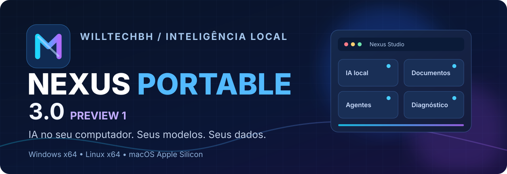
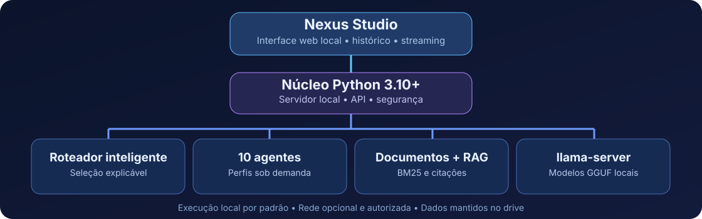

<div align="center">



# WillTechBH IA Nexus Portable 3.0

**Uma IA local para seus documentos, conversas e tarefas — executada no seu computador.**

[](https://github.com/hebwil/ia-offline/releases/tag/v3.0.0-preview.1)
[](https://github.com/hebwil/ia-offline/actions/runs/43973139797)


**[⬇️ Baixar a versão 3.0](https://github.com/hebwil/ia-offline/releases/tag/v3.0.0-preview.1)** · **[Instalação](docs/INSTALACAO.md)** · **[Arquitetura](docs/ARQUITETURA.md)** · **[Testes](docs/TESTES.md)** · **[Limitações](docs/LIMITACOES.md)**

</div>

> **Preview pública — 16 de novembro de 2026.** Windows x64, Linux x64 e macOS ARM64 passaram em runners nativos do GitHub Actions, incluindo inferência real. Isso não substitui ensaios em todos os computadores e configurações de GPU.

## O que você pode fazer

| Recurso | Na prática |
|:--|:--|
| **Chat com IA local** | Converse usando modelos GGUF executados pelo `llama-server`; modo offline por padrão. |
| **Nexus Studio** | Interface web local com histórico, streaming, tema claro/escuro e diagnóstico. |
| **Seus documentos** | Consulte PDFs textuais, DOCX, XLSX, CSV, TXT e Markdown com busca BM25 e citações de arquivo/página. |
| **Roteamento inteligente** | O sistema avalia a tarefa e os recursos disponíveis para recomendar modelo, contexto e perfil de agente. |
| **10 agentes especializados** | Perfis de instruções sob demanda, sem manter dez modelos carregados. |
| **Modelos gerenciados** | Downloads autorizados, retomada, verificação SHA-256 e seleção manual. |
| **Privacidade** | API em `127.0.0.1`, pesquisa externa desligada por padrão, controles de acesso locais. |

## Conheça a arquitetura



Interface web → servidor local Python 3.10+ → roteador/agentes/documentos → motor llama.cpp e modelos GGUF. O código do núcleo não exige instalação de pacotes por `pip`, mas **exige Python 3.10+ já disponível ou runtime portátil configurado**.

## Downloads: escolha o pacote certo

| Edição | Para quem é | Conteúdo | Internet no primeiro uso |
|:--|:--|:--|:--|
| **Nexus Lite ZIP** | Principalmente Windows; fonte portátil para outras plataformas | Aplicação, interface, inicializadores e documentação (~416 KiB) | **Sim**, para obter motor e modelo |
| **Nexus Lite TAR.GZ** | macOS e Linux | Mesmo núcleo leve (~453 KiB) | **Sim**, para obter motor e modelo |
| **Offline Complete — macOS ARM64** | Apple Silicon | Aplicação + `llama-server` b12444 + Qwen3 0.6B Q8_0 (~618 MiB) | **Não** para o primeiro chat, desde que Python compatível esteja disponível |

**Arquivos oficiais:** [Release e anexos](https://github.com/hebwil/ia-offline/releases/tag/v3.0.0-preview.1) · [Checksums SHA-256](https://github.com/hebwil/ia-offline/releases/download/v3.0.0-preview.1/SHA256SUMS.txt).

**Importante:** o Lite **não** contém motor e modelo. O Offline Complete é distribuído nesta preview **somente para macOS ARM64**. Nenhum deles é um instalador tradicional independente de Python. Leia os requisitos antes de baixar.

## Comece em 3 passos

1. **Baixe e extraia** a edição correspondente na pasta ou unidade desejada. [Veja o passo a passo por sistema](docs/INSTALACAO.md).
2. **Lite apenas:** entre na pasta extraída e prepare o motor e um modelo:

   **Windows (PowerShell ou Terminal):**
   ```powershell
   py -3 nexus3.py setup --yes
   py -3 nexus3.py models install qwen3-0.6b-q8 --yes
   py -3 nexus3.py start
   ```

   **macOS / Linux:**
   ```bash
   python3 nexus3.py setup --yes
   python3 nexus3.py models install qwen3-0.6b-q8 --yes
   python3 nexus3.py start
   ```

3. **Offline Complete no Mac Apple Silicon:** extraia preservando symlinks e execute `python3 nexus3.py start` na pasta do aplicativo. A interface abre em `http://127.0.0.1:<porta>/` (a porta aparece no terminal). Não é necessário baixar um modelo no primeiro uso dessa edição.

Atalhos opcionais: `scripts/start-windows.bat`, `scripts/start-macos.command` e `scripts/start-linux.sh`. Eles **não substituem** a preparação do Lite.

> **Segurança:** `--yes` autoriza downloads externos dos componentes especificados. Use somente os pacotes da Release e confira o SHA-256. O sistema operacional pode criar caches ou registros no computador; não prometemos “zero rastros”.

## Homologação e transparência

| Plataforma | Situação comprovada | Pacote offline completo |
|:--|:--|:--|
| Windows x64 | ✅ CI nativo + inferência local real | Ainda não publicado |
| Linux x64 | ✅ CI nativo + inferência local real | Ainda não publicado |
| macOS ARM64 (Apple Silicon) | ✅ CI nativo + inferência local real + extração limpa local do Offline Complete | ✅ Publicado |
| Windows ARM64, Linux ARM64, macOS Intel | ⚠️ Não homologadas nesta preview | Não publicado |

**Evidências:** [CI final — 13/13 jobs](https://github.com/hebwil/ia-offline/actions/runs/43973139797) · [Homologação com inferência real](https://github.com/hebwil/ia-offline/actions/runs/43971732157) · [Detalhes dos testes](docs/TESTES.md). A suíte automatizada teve **64/64 testes aprovados** em Python 3.10, 3.12 e 3.13 nas três plataformas principais.

**Limitações relevantes:** GPU CUDA/ROCm/Vulkan sem homologação específica; OCR requer Tesseract; busca semântica por embeddings não está ativa por padrão; tool calling do modelo, shell Tauri e auto-update não integram esta preview. O modelo Qwen3 0.6B incluído no Offline Complete serve como base leve; qualidade para tarefas exigentes varia com o modelo escolhido.

## Documentação

| Documento | Conteúdo |
|:--|:--|
| [Instalação e solução de problemas](docs/INSTALACAO.md) | Requisitos, comandos por sistema, Lite vs Offline e pendrive/SSD |
| [Arquitetura](docs/ARQUITETURA.md) | Fluxos, módulos, segurança e API |
| [Testes e evidências](docs/TESTES.md) | O que foi comprovado e o que não foi |
| [Limitações](docs/LIMITACOES.md) | Restrições atuais, compatibilidade e roadmap |
| [Licenças e terceiros](docs/THIRD-PARTY.md) | Origem de componentes incorporados e seus termos |
| [Changelog](CHANGELOG.md) | Histórico técnico da versão 3.0 |

## Histórico do projeto

A **v1.0/v2.0** permanece arquivada no GitHub. A **v3.0** adota uma arquitetura diferente, com Python, llama.cpp e Nexus Studio própria. O código mais recente está na branch [`develop/v3.0`](https://github.com/hebwil/ia-offline/tree/develop/v3.0); a [release Preview 1](https://github.com/hebwil/ia-offline/releases/tag/v3.0.0-preview.1) corresponde ao commit `2501b81a9e3db3dea9c0dfa15d25abc1684ec895`.

---

<div align="center">

**WillTechBH · IA local, com controle sobre seus dados.**

[Baixar](https://github.com/hebwil/ia-offline/releases/tag/v3.0.0-preview.1) · [Ver código](https://github.com/hebwil/ia-offline/tree/develop/v3.0) · [Ver CI](https://github.com/hebwil/ia-offline/actions)

</div>
