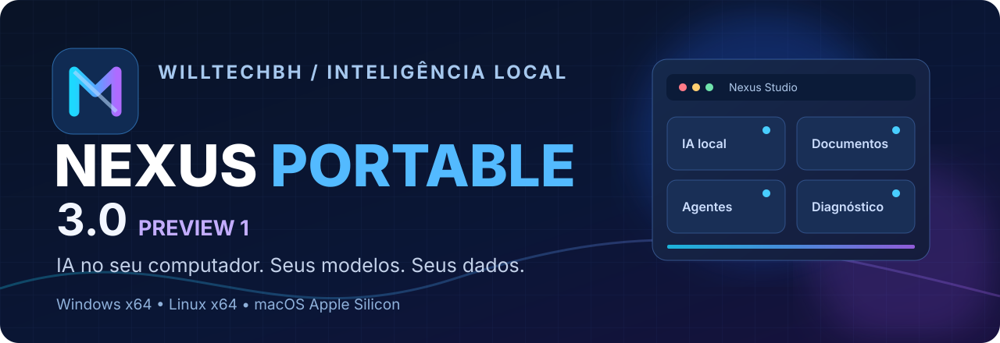

# Baixar e instalar — Nexus Portable 3.0 (Preview 1)

> **Versão mais recente para testes:** [v3.0.0-preview.1](https://github.com/hebwil/ia-offline/releases/tag/v3.0.0-preview.1), publicada em 16 de novembro de 2026. **A versão v2.0.0 pode aparecer como “Latest”** porque o GitHub considera essa a última versão estável. A 3.0 é pública, mas está corretamente classificada como *pre-release*.



## 1. Escolha seu download

| Seu computador | Download direto | Conteúdo / tamanho aproximado |
|---|---|---|
| **Windows 10/11 x64** | **[Baixar Nexus Lite para Windows — ZIP](https://github.com/hebwil/ia-offline/releases/download/v3.0.0-preview.1/Nexus-Lite-3.0-all-20261116.zip)** | Núcleo + interface + scripts (416 KiB). **Exige internet na primeira preparação.** |
| **Linux x64** | **[Baixar Nexus Lite para Linux — TAR.GZ](https://github.com/hebwil/ia-offline/releases/download/v3.0.0-preview.1/Nexus-Lite-3.0-all-20261116.tar.gz)** | Mesmos componentes (453 KiB). **Exige internet na primeira preparação.** |
| **Mac Apple Silicon (M1/M2/M3/M4/M5)** | **[Baixar Nexus Offline Complete — TAR.GZ](https://github.com/hebwil/ia-offline/releases/download/v3.0.0-preview.1/Nexus-Offline-Complete-3.0-macos-arm64-20261116.tar.gz)** | Motor llama.cpp + Qwen3 0.6B + interface (618 MiB). **Não exige download de modelo ou motor.** |
| **Mac Apple Silicon — instalação leve** | [Nexus Lite — TAR.GZ](https://github.com/hebwil/ia-offline/releases/download/v3.0.0-preview.1/Nexus-Lite-3.0-all-20261116.tar.gz) | Requer baixar o motor e um modelo depois. |

[**Ver todos os arquivos da Release 3.0**](https://github.com/hebwil/ia-offline/releases/tag/v3.0.0-preview.1) · [**Baixar SHA256SUMS.txt**](https://github.com/hebwil/ia-offline/releases/download/v3.0.0-preview.1/SHA256SUMS.txt)

**Não baixe “Source code (zip)” como substituto automático do instalador.** Esse arquivo é um pacote gerado pelo GitHub a partir da tag, para consultar o código, não um pacote preparado e testado como os anexos acima. Os arquivos oficiais estão na seção **Assets** da Release.

### Requisitos em comum

- **Python 3.10 ou superior**, instalado no computador ou disponibilizado como runtime portátil compatível. O pacote **não** instala Python automaticamente.
- Um sistema operacional/arquitetura compatível. A homologação por inferência real em CI cobre **Windows x64, Linux x64 e macOS ARM64**.
- RAM e espaço suficientes para o modelo. O Qwen3 0.6B utiliza cerca de 639 MB em arquivo; runtime, caches, contexto e espaço livre exigem margem adicional.
- **Nexus Lite:** internet para os primeiros downloads autorizados de motor e modelo. Depois de preparado, pode operar offline.
- **Offline Complete macOS ARM64:** motor e modelo já incluídos; ainda precisa do Python compatível.

## 2. Instalação por sistema

### Windows 10/11 x64 — Nexus Lite

1. Baixe o **[ZIP do Windows](https://github.com/hebwil/ia-offline/releases/download/v3.0.0-preview.1/Nexus-Lite-3.0-all-20261116.zip)**.
2. Clique em **Extrair tudo**. Abra a pasta extraída que contém `nexus3.py`. Não execute `install.bat` ou `start-windows.bat` antigos da branch `main`: eles pertencem à versão legada.
3. No Explorador de Arquivos, entre nessa pasta e abra um **Terminal/PowerShell** ali (ou digite `powershell` na barra de endereço).
4. Verifique a versão do Python e prepare o motor/modelo:

```powershell
py -3 --version
py -3 nexus3.py setup --yes
py -3 nexus3.py models install qwen3-0.6b-q8 --yes
py -3 nexus3.py doctor
py -3 nexus3.py start
```

5. O navegador abre a interface **Nexus Studio**. A porta local também é informada no terminal. Nos próximos usos, com tudo preparado, execute `scripts\start-windows.bat` ou `py -3 nexus3.py start`.

Se `py -3` não estiver disponível, teste `python --version` (precisa ser 3.10+) e substitua `py -3` por `python`.

### Linux x64 — Nexus Lite

1. Baixe o **[TAR.GZ Lite](https://github.com/hebwil/ia-offline/releases/download/v3.0.0-preview.1/Nexus-Lite-3.0-all-20261116.tar.gz)**.
2. Extraia e abra um terminal na pasta com `nexus3.py`.
3. Verifique Python 3.10+ e execute:

```bash
python3 --version
python3 nexus3.py setup --yes
python3 nexus3.py models install qwen3-0.6b-q8 --yes
python3 nexus3.py doctor
python3 nexus3.py start
```

Para os próximos usos: `bash scripts/start-linux.sh`. Permissões e bibliotecas dependem da distribuição; a homologação registrada foi em Ubuntu x64 no GitHub Actions.

### macOS Apple Silicon — Offline Complete

1. Baixe o **[TAR.GZ Offline Complete](https://github.com/hebwil/ia-offline/releases/download/v3.0.0-preview.1/Nexus-Offline-Complete-3.0-macos-arm64-20261116.tar.gz)**.
2. Extraia com o `tar` nativo para preservar os links de bibliotecas. Exemplo (ajuste a pasta de destino e o nome do arquivo, se necessário):

```bash
mkdir -p "$HOME/Nexus3"
tar -xzf "$HOME/Downloads/Nexus-Offline-Complete-3.0-macos-arm64-20261116.tar.gz" -C "$HOME/Nexus3"
```

3. Entre na pasta extraída que **contém `nexus3.py`**, confirme Python 3.10+ e inicie:

```bash
python3 --version
python3 nexus3.py doctor
python3 nexus3.py start
```

O pacote inclui o motor e o modelo Qwen3 0.6B Q8_0. **Não execute `setup` nem `models install` novamente** se esses componentes já foram reconhecidos e validados. Se o macOS bloquear a execução, revise permissões e quarentena do arquivo baixado antes de decidir qualquer alteração; não desative a segurança global do sistema.

## 3. Verifique o SHA-256

Baixe o arquivo [SHA256SUMS.txt](https://github.com/hebwil/ia-offline/releases/download/v3.0.0-preview.1/SHA256SUMS.txt) e compare o hash do pacote antes de extrair.

**Windows — PowerShell:**

```powershell
Get-FileHash -Algorithm SHA256 ".\Nexus-Lite-3.0-all-20261116.zip"
```

**macOS:**

```bash
shasum -a 256 Nexus-Offline-Complete-3.0-macos-arm64-20261116.tar.gz
```

**Linux:**

```bash
sha256sum Nexus-Lite-3.0-all-20261116.tar.gz
```

O resultado deve ser idêntico à linha do respectivo arquivo em `SHA256SUMS.txt`. Se for diferente, não execute o pacote; faça novo download da Release oficial.

## 4. Perguntas comuns

**Por que a v2.0 aparece como “Latest”?** Porque a v3.0 está publicada como **Preview**. O GitHub reserva o indicador “Latest” para releases não marcadas como pré-lançamento. A versão mais nova para testes é a [v3.0.0-preview.1](https://github.com/hebwil/ia-offline/releases/tag/v3.0.0-preview.1).

**Qual pacote funciona totalmente offline?** Nesta publicação, o **Offline Complete para macOS ARM64** contém motor e modelo, mas ainda exige Python compatível. O Lite precisa de internet na primeira preparação; depois, o chat local pode operar offline.

**Consigo usar no Windows ou Linux sem Python?** Não com os pacotes atuais. Eles exigem Python 3.10+ no host ou runtime portátil configurado. Um instalador com runtime embarcado não foi publicado nesta Preview.

**É um aplicativo com janela própria?** A interface Nexus Studio abre no navegador por meio de um servidor HTTP **local**, não é um executável Tauri/Electron nativo nesta versão.

**Por que o modelo incluído é pequeno?** O Qwen3 0.6B permite teste inicial leve. Tarefas mais difíceis podem exigir um modelo maior, hardware apropriado e download autorizado.

**Funciona com GPU?** A homologação publicada não prova CUDA/ROCm/Vulkan em GPUs dedicadas; a execução em CPU é o caminho base.

**Por que está na branch `develop/v3.0`?** O projeto original preserva na `main` os arquivos legados. O código da versão mais nova está [aqui](https://github.com/hebwil/ia-offline/tree/develop/v3.0), enquanto os instaladores/pacotes estão na [Release v3.0](https://github.com/hebwil/ia-offline/releases/tag/v3.0.0-preview.1).

## 5. Testes e limitações

- [Matriz de homologação e evidências](TESTES.md)
- [Limitações conhecidas](LIMITACOES.md)
- [Arquitetura e funcionamento](ARQUITETURA.md)

© WillTechBH. O programa combina componentes próprios e de terceiros com licenças específicas — veja [THIRD-PARTY.md](THIRD-PARTY.md).
